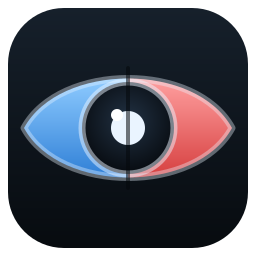

# 峡谷斥候 · RiftScout

<p align="left">
  
</p>

在《英雄联盟》开局前后，把这场对局的十个人摆到一块屏幕上看清楚：谁和你同队、谁在对面、各自什么段位、最近打得怎么样。数据全部来自本机客户端，不上传任何内容。

> 非官方工具，与 Riot Games 无关。

## 功能

- **自动侦测对局**：只轮询客户端阶段状态（每 5 秒一次轻量请求），进入选人 / 对局时自动拉取双方十人名单。
- **十人一屏**：两支队伍左右并排，每人一行，行内横铺最近若干场战绩，适配 16:9 横屏，不需要滚动。
- **逐场战绩**：每场显示模式、英雄、胜负与 KDA，点击任意一场可以看到该局的双方十人详情。
- **按模式分模板**：对局详情按模式切换模板，例如海克斯大乱斗 / 斗魂会额外展示每名玩家本局选到的海克斯，鼠标悬停显示中文名，并按白银 / 黄金 / 棱彩区分稀有度。
- **个人战绩查询**：输入「名字#TAG」查询任意玩家，最多拉取约 300 场历史；在对局侦察页点击任意玩家名，可直接跳到他的历史战绩。
- **手动刷新**：对局数据不会自动反复查询，避免触碰客户端的战绩查询限速；需要更新时点右上角「刷新」。

## 环境要求

- Windows 10 / 11
- 已安装并登录《英雄联盟》客户端（国服 / 国际服均可）
- **需要管理员权限**：客户端通常以管理员身份运行，只有提权才能读到它的本地认证参数

## 直接使用

到 [Releases](../../releases) 下载最新的峡谷斥候，双击运行即可，会弹出 UAC 提权确认，不需要安装。

## 从源码运行

```bash
# 需要 Node.js >= 22.6（原生 TypeScript 支持）
npm install
npm --prefix web install

# 只跑桥接服务（浏览器访问 http://127.0.0.1:8737）
npm start

# 桥接服务 + 前端热更新
npm run web

# Electron 桌面窗口
npm run desktop
```

## 打包

```bash
npm run dist
```

产物在 `release/`，使用 electron-builder 的 portable 目标，图标取自 `build/icon.ico`。

## 工作原理

```
Electron 窗口 ──> 本地桥接服务 (127.0.0.1:8737) ──> LCU API (127.0.0.1:<客户端端口>)
```

- 桥接服务从客户端进程参数（或 `lockfile`）读取端口与 `remoting-auth-token`，用 Basic Auth 访问本地 LCU API，不需要 Riot 官方 API Key。
- 段位、战绩、英雄 / 装备 / 海克斯图标都走本地客户端资源或 LCU 接口，图标由桥接服务代理，前端不直连客户端。
- 历史战绩优先走 LCU 的区间查询，不足时回退到 SGP 分页接口，单次最多约 300 场。

## 隐私

- 所有请求都发生在 `127.0.0.1`，不向任何外部服务器发送数据。
- 不写入账号密码，也不持久化认证 token；客户端关闭后即失效。
- 仅在本地临时目录记录最近一次的服务大区（`platformId`），用于下次启动时少一次探测。

## 已知限制

- 仅支持 Windows（依赖读取进程参数与客户端本地接口）。
- 选人阶段官方会隐藏对手信息，此时敌方一侧显示占位行。
- 客户端自身有限速，冷缓存下查询大量场次可能需要十几秒，界面会自动重试。
- 斗魂等模式的 5 / 6 枚海克斯未做全量实机验证，字段与海克斯大乱斗同源。

## 免责声明

本项目为个人学习与自用工具，不隶属于 Riot Games，也未获得其认可或赞助。《英雄联盟》及相关素材、角色、图标归 Riot Games 所有。请自行承担使用风险，并遵守游戏与客户端的使用条款。

## 许可证

[MIT](LICENSE)
